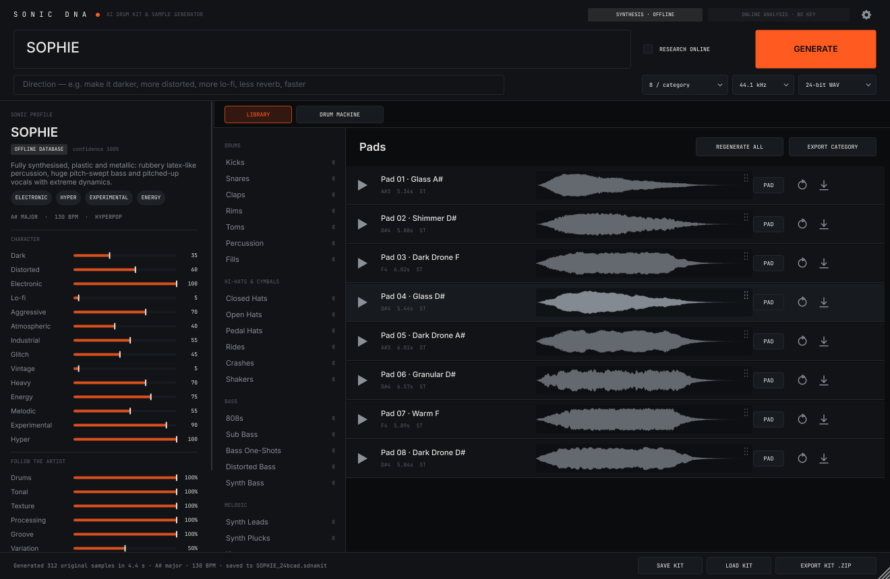
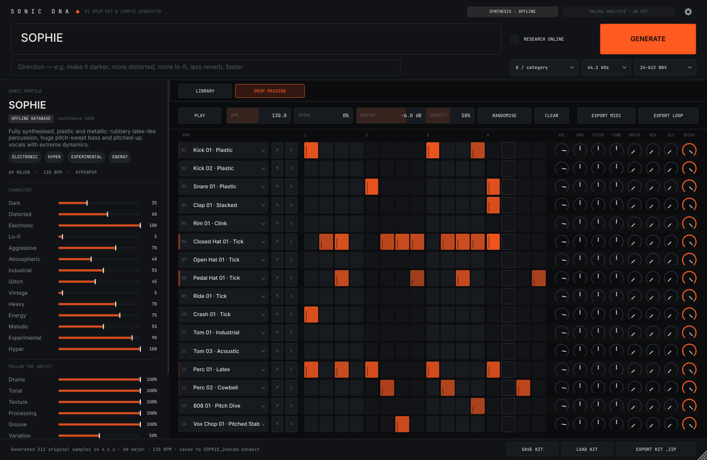

# SONIC DNA — AI Drum Kit & Sample Generator

Type an artist, producer or genre → SONIC DNA builds a sonic profile and **synthesises a
complete, original, musically coherent sample pack**: 39 categories (drums, cymbals, bass,
melodic, sound design, vocal textures), 5–20 variations each, plus a 16-pad drum machine to
audition it, and exports to WAV / ZIP / MIDI / loops. Runs as a **standalone app** and a
**VST3 plugin** (AU on macOS).




## Download and run (no coding needed)

1. Open this repository on GitHub → **Actions** tab → latest **Build** run → scroll to **Artifacts**.
2. Download `SONIC-DNA-macOS`, `SONIC-DNA-Windows` or `SONIC-DNA-Linux` and unzip it.
3. **Standalone app:** open `SONIC DNA` (`SONIC DNA.exe` on Windows, `SONIC DNA.app` on macOS).
   The builds are not code-signed: on macOS right-click → *Open* the first time; on Windows click
   *More info → Run anyway*.
4. **Plugin:** copy `SONIC DNA.vst3` into your VST3 folder, then rescan plugins in your DAW:
   * Windows: `C:\Program Files\Common Files\VST3`
   * macOS: `~/Library/Audio/Plug-Ins/VST3` (Logic Pro: copy `SONIC DNA.component` to `~/Library/Audio/Plug-Ins/Components`)
   * Linux: `~/.vst3`
5. Type an artist, press **GENERATE**, audition in the Library, play the Drum Machine, export.

## Status — what works today

| Feature | Status |
|---|---|
| Artist / producer / genre analysis (offline database, fuzzy match, "X meets Y" blends, descriptive phrases) | ✅ working, tested |
| Online research with Claude + web search (needs internet + your Anthropic API key) | ✅ implemented; request/response handling unit-tested with canned responses — **not exercised against the live API in development (no key available)** |
| Editable profile (14 descriptors), per-aspect "follow the artist" amounts, variation | ✅ |
| Direction prompt ("much darker, less reverb, more industrial, faster") with live preview of what was understood | ✅ |
| Procedural generation of all 39 categories, 1–20 variations each (312 samples in ~5 s on 3 cores) | ✅ |
| Key/tempo-coherent kits (shared key, progression, tempo, processing "DNA") | ✅ |
| Per-sample regenerate, audition, WAV export, assign to pad, drag & drop (to pads and out to the OS/DAW as WAV) | ✅ (external drag implemented via JUCE; not tested inside a real DAW here) |
| Drum machine: 16 pads × 16 steps, velocity, BPM, swing, per-pad volume/pan/pitch/tone/drive/reverb/delay/decay, mute/solo, hat choke, groove-aware randomiser, MIDI input (C1–D#2), host-tempo sync | ✅ |
| Export: WAV 16/24/32f @ 44.1/48 kHz, full kit ZIP (folders + kit.json + README + MIDI + rendered loop), MIDI pattern, seamless loops | ✅ |
| Save / load kits (`.sdnakit`, lossless), auto-save, DAW session recall | ✅ |
| VST3 (Linux build validated with a hosting test), Standalone | ✅ Linux. macOS/Windows: CMake is set up, **not built/tested here** |

## Important limitations (honest list)

* **Sounds are DSP-synthesised, not neural-generated.** Quality is "good synth/drum-machine
  sound design", varied and on-profile, but it will not sound like a specific record and
  some categories (piano, strings, vocals) are clearly synthetic. Vocal elements use formant
  synthesis: wordless "aah/ooh/hey" voices, not realistic singing. A neural engine can be
  plugged in later (see `docs/ARCHITECTURE.md`).
* **Offline analysis is a curated table**, not live research: 89 artists + 43 genres. Unknown
  names get a clearly-labelled low-confidence *approximation* — use online research or the
  sliders.
* **No samples are downloaded or copied.** The profile only steers synthesis parameters; nothing
  from recordings is used, so kits are "inspired by", never recreations.
* The API key is stored in plain text in the user settings file (or use the
  `SONICDNA_ANTHROPIC_API_KEY` environment variable).
* Memory: a kit is held in RAM as float (≈200–300 MB at 8/category, ~2.5× at 20/category).
* Sounds were checked with automated measurements and spectrograms (see
  `docs/images/*contact_sheet.png`) — they still deserve a listening pass by a producer.

## Build

Requirements: CMake ≥ 3.22, a C++17 compiler, JUCE 8 sources.

```bash
git clone --depth 1 --branch 8.0.4 https://github.com/juce-framework/JUCE.git third_party/JUCE
```

```bash
cmake -S . -B build -G Ninja -DCMAKE_BUILD_TYPE=Release
```

```bash
cmake --build build
```

Linux packages: `libasound2-dev libfreetype-dev libfontconfig1-dev libx11-dev libxrandr-dev
libxinerama-dev libxcursor-dev libxext-dev libcurl4-openssl-dev libgl1-mesa-dev`.

Outputs: `build/plugin/SonicDNA_artefacts/Release/{Standalone,VST3}` and `build/sonicdna` (CLI).
Core-only build (no JUCE): `-DSDNA_BUILD_PLUGIN=OFF`.

## Test

```bash
./build/sdna_tests
```

```bash
build/plugin/SonicDNAHostTest_artefacts/Release/SonicDNAHostTest "build/plugin/SonicDNA_artefacts/Release/VST3/SONIC DNA.vst3" path/to/kit.sdnakit
```

The standalone can drive itself end-to-end and save screenshots (used for UI verification):

```bash
SONICDNA_AUTOTEST=/tmp/sdna_ui SONICDNA_AUTOTEST_QUERY="Burial" "build/plugin/SonicDNA_artefacts/Release/Standalone/SONIC DNA"
```

## CLI

```bash
./build/sonicdna generate "Crystal Castles" --prompt "darker, more lo-fi" --per 10 --sr 48000 --bits 24 --zip CrystalCastles.zip
```

`sonicdna analyze "<query>"` prints the profile; `sonicdna list` lists the database.

## Using it

1. Type an artist/producer/genre (autocomplete suggests known ones). Optional: tick
   **RESEARCH ONLINE** (needs key in ⚙ Settings).
2. Optionally add a **Direction**; the profile panel shows exactly which words were understood.
3. Adjust descriptors and **Follow the artist** amounts, choose variations / sample rate / bit depth.
4. **GENERATE**. Browse the **Library**, audition, regenerate single sounds, drag to pads or to your DAW.
5. **Drum Machine**: RANDOMISE in a style, edit steps (click; drag vertically = velocity;
   shift-click = accent; right-click = ghost), mix, export MIDI/loop.
6. **EXPORT KIT .ZIP** / **SAVE KIT**.

In a DAW: put SONIC DNA on an instrument track; MIDI notes C1–D#2 play pads 1–16; the
sequencer follows the host transport while it plays.

## Licensing notes

* JUCE is dual-licensed (AGPLv3 / commercial). **Selling this product closed-source requires a
  JUCE commercial licence.** The VST3 SDK bundled with JUCE has its own licence terms —
  check them for your distribution.
* Embedded fonts: Inter and JetBrains Mono (SIL Open Font License, see `plugin/Resources/fonts/licenses`).
* Artist names are used only as search queries/descriptors; the product does not imply
  endorsement. Consider trademark guidance before marketing with artist names.
